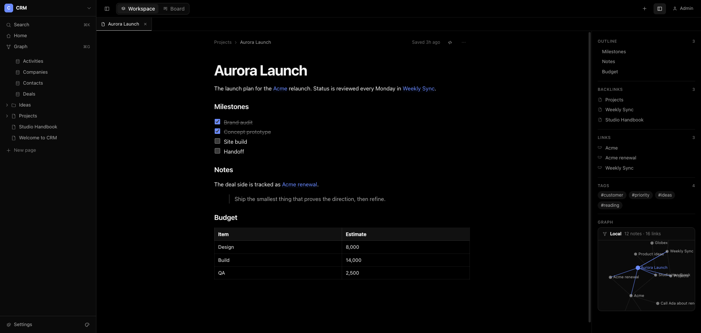
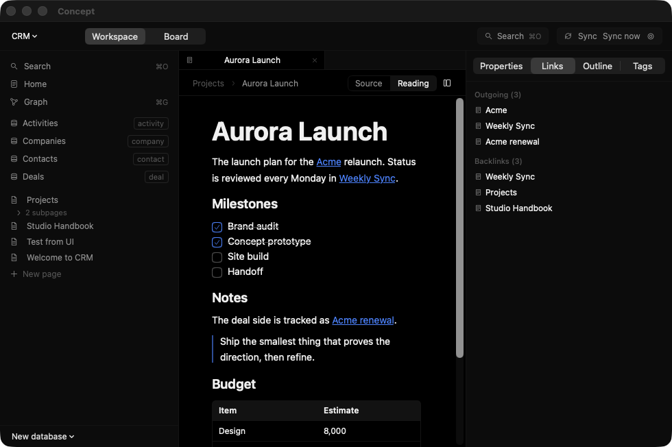

# Concept

Pages, databases and boards for teams that want their content in plain Markdown.
Use a local folder in the native Mac app, or self-host the web app for shared
workspaces, roles and folder permissions. Both support Git sync.

<p align="center">
  
</p>

## Install

**macOS 14+, Apple silicon and Intel:** download
[Concept-macos-universal.zip](https://github.com/michael-berardi/concept/releases/latest/download/Concept-macos-universal.zip),
unzip it in Finder and open `Concept.app`. Release archives and checksums are on
[the releases page](https://github.com/michael-berardi/concept/releases/latest).
Open a Markdown folder, or create a vault from the CRM template. Edit a page or
drag a deal to another board column; the changes are saved in your folder.
Use the Sync button after configuring a Git remote.

### From source

**Self-hosted web app:** with Git and Docker Compose installed:

```sh
git clone https://github.com/michael-berardi/concept.git
cd concept
docker compose up -d
```

Open <http://localhost:8787> and create the first account to become the admin.
The app creates a CRM workspace. Data and the generated encryption secret persist
in the `concept-data` volume. Back up the whole volume, not just the Markdown.
For Node installation, TLS and configuration, see [self-hosting](docs/SELF-HOSTING.md).

## Work with your files

- Pages have properties, wiki links and backlinks. The web app adds a block
  editor, outline and graph; the Mac app has a Markdown editor and preview.
- Databases have tables and draggable boards. The CRM template includes
  Companies, Contacts, Deals and Activities.
- The server adds accounts, teams, invite links, comments and folder permissions.
- External file edits are watched and re-indexed. Vaults also work with
  [Retex](https://github.com/michael-berardi/retex).
- Six themes: OLED, Graphite, Paper, Snow, Midnight and Forest.

<p align="center">
  
  
  
</p>

Pages live in `Pages/`, database rows in `Data/<database>/`, attachments in
`Attachments/`, and schemas in `.concept/`. Pages and rows are Markdown with YAML
frontmatter. Accounts, permissions and comments live in the server's SQLite
database, not in the vault. See the [format](docs/SPEC.md) and [REST API](docs/API.md).

## Privacy

Concept sends nothing over the network by default. The macOS app reads and writes the Markdown folder you open. The web app talks only to the self-hosted server that serves it. There is no telemetry, analytics, crash reporting, update check, install ID or third-party font/script loaded into the UI.

Network features happen only when you set them up:

- Git sync fetches from and pushes to the remote URL you configure. Your token is sent only to that host. The server checks an enabled remote every 60 seconds; turn sync off in workspace settings to stop it.
- Self-hosted clients send the pages, edits and attachments you make to your own server. ConceptKit also includes a REST client for a server you configure.
- Downloading the macOS release from GitHub is a click you make; the app itself never checks for updates.

Locally, the Mac app keeps your pages in the vault folder, recent vault paths and pinned paths in macOS `UserDefaults`, and an optional sync token in the macOS Keychain (`dev.concept.vault-sync`). Files and folders Concept creates use 0600/0700 permissions. The server keeps accounts, session hashes, comments, activity, sync settings and the search index in `$CONCEPT_DATA_DIR/concept.db`, vaults in `$CONCEPT_DATA_DIR/workspaces/`, and an encryption secret in `$CONCEPT_DATA_DIR/.instance-secret`. A generated admin password is written to `$CONCEPT_DATA_DIR/admin-password.txt` (0600), never printed. Each new activity entry prunes entries older than 90 days; pages you delete stay in the vault's `.trash/` until you remove them. Git tokens are encrypted at rest. The browser stores theme and panel state in `localStorage`.

To delete everything: stop the server and remove the data directory (or the `concept-data` Docker volume). In the Mac app, delete the vault folder, clear the app's `recentVaults` and `pinnedPaths-…` keys in macOS `UserDefaults`, and delete the `dev.concept.vault-sync` Keychain item if you saved a token. Clear site data for your server in the browser.

The only third parties that receive data are the ones you configure: your Git host receives the vault contents you sync, and your self-hosted server receives the content you send to it.

## Develop

Use Node 22.13+ and pnpm 10.27.0. Build before testing: the server's static-serving
test needs the web bundle in `server/public`.

```sh
pnpm install --frozen-lockfile
pnpm build
pnpm -r test
cd macos
swift test -j 4
```

The Mac package requires Swift 6 and macOS 14+. `macos/scripts/bundle.sh` packages
a universal app; it ad-hoc signs by default. Developer ID signing and notarization
require `CONCEPT_SIGNING_IDENTITY` and `CONCEPT_NOTARY_PROFILE`.

## License

MIT

---

Part of [Pareto Cybernetics](https://paretocybernetics.com/projects/concept/): free, private, open-source tools for working with AI agents.
