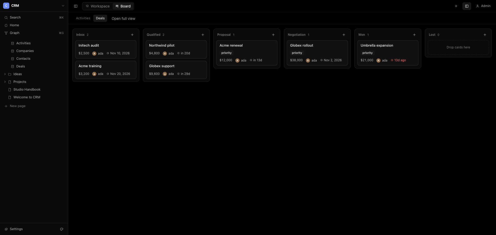
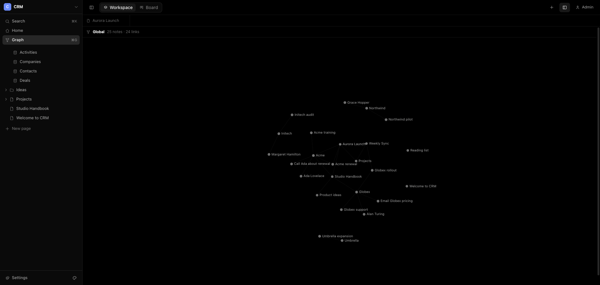

# Concept

Pages, databases and boards for teams that want their content in plain Markdown.
Use a local folder in the native Mac app, or self-host the web app for shared
workspaces, roles and folder permissions. Both support Git sync.

<p align="center">
  
</p>

## Install

**macOS 14+, Apple silicon and Intel:** download
[Concept-macos-universal.zip](https://github.com/michael-berardi/concept/releases/latest/download/Concept-macos-universal.zip),
unzip it in Finder and open `Concept.app`. Release archives and checksums are on
[the releases page](https://github.com/michael-berardi/concept/releases/latest).
Open a Markdown folder, or create a vault from the CRM template. Edit a page or
drag a deal to another board column; the changes are saved in your folder.
Use the Sync button after configuring a Git remote.

### From source

**Self-hosted web app:** with Git and Docker Compose installed:

```sh
git clone https://github.com/michael-berardi/concept.git
cd concept
docker compose up -d
```

Open <http://localhost:8787> and create the first account to become the admin.
The app creates a CRM workspace. Data and the generated encryption secret persist
in the `concept-data` volume. Back up the whole volume, not just the Markdown.
For Node installation, TLS and configuration, see [self-hosting](docs/SELF-HOSTING.md).

## Updates

The Mac app checks for a new release once a day and shows the standard update
prompt; automatic installation stays off until you turn it on in **Settings →
Updates**. Self-hosted servers show instance admins a notice with the upgrade
command and never update themselves. See [updates](docs/updates.md).

## Work with your files

- Pages have properties, wiki links and backlinks. The web app adds a block
  editor, outline and graph; the Mac app has a Markdown editor and preview.
- Databases have tables and draggable boards. The CRM template includes
  Companies, Contacts, Deals and Activities.
- The server adds accounts, teams, invite links, comments and folder permissions.
- External file edits are watched and re-indexed. Vaults also work with
  [Retex](https://github.com/michael-berardi/retex).
- Six themes: OLED, Graphite, Paper, Snow, Midnight and Forest.

<p align="center">
  
  
  
</p>

Pages live in `Pages/`, database rows in `Data/<database>/`, attachments in
`Attachments/`, and schemas in `.concept/`. Pages and rows are Markdown with YAML
frontmatter. Accounts, permissions and comments live in the server's SQLite
database, not in the vault. See the [format](docs/SPEC.md) and [REST API](docs/API.md).

## Develop

Use Node 22.13+ and pnpm 10.27.0. Build before testing: the server's static-serving
test needs the web bundle in `server/public`.

```sh
pnpm install --frozen-lockfile
pnpm build
pnpm -r test
cd macos
swift test -j 4
```

The Mac package requires Swift 6 and macOS 14+. `macos/scripts/bundle.sh` packages
a universal app; it ad-hoc signs by default. Developer ID signing and notarization
require `CONCEPT_SIGNING_IDENTITY` and `CONCEPT_NOTARY_PROFILE`; a release also
needs the Sparkle signing key ([publishing a Mac release](docs/updates.md#publishing-a-mac-release)).

## Privacy

No telemetry. Besides Git sync you configure, Concept's only request is one
anonymous update check a day; turn it off in **Settings → Updates** or with
`CONCEPT_NO_UPDATE_CHECK=1`. Your pages stay in your vault folder or on your
server, in owner-only files. To remove everything, delete the vault and the
server's data directory. Details: [PRIVACY.md](PRIVACY.md).

## License

MIT

---

Part of [Pareto Cybernetics](https://paretocybernetics.com/projects/concept/): free, private, open-source tools for working with AI agents.
